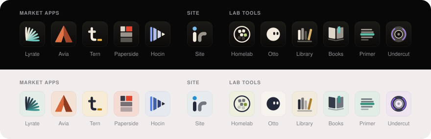
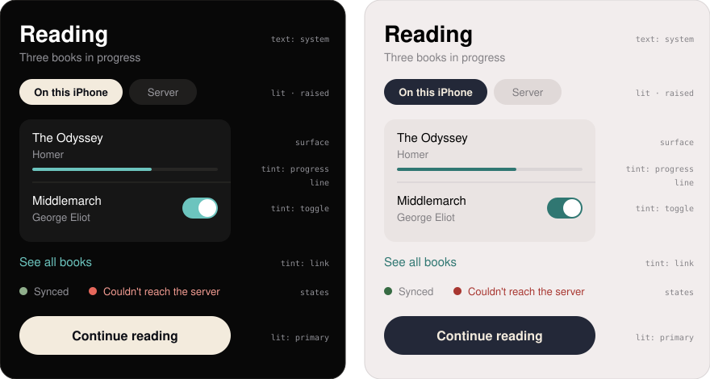
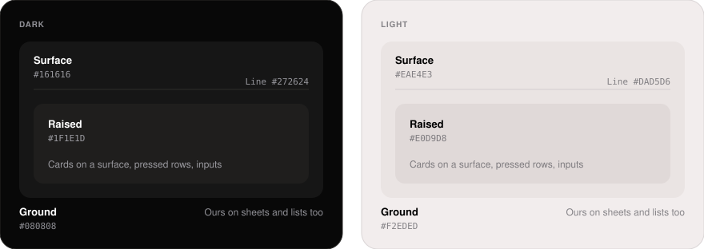
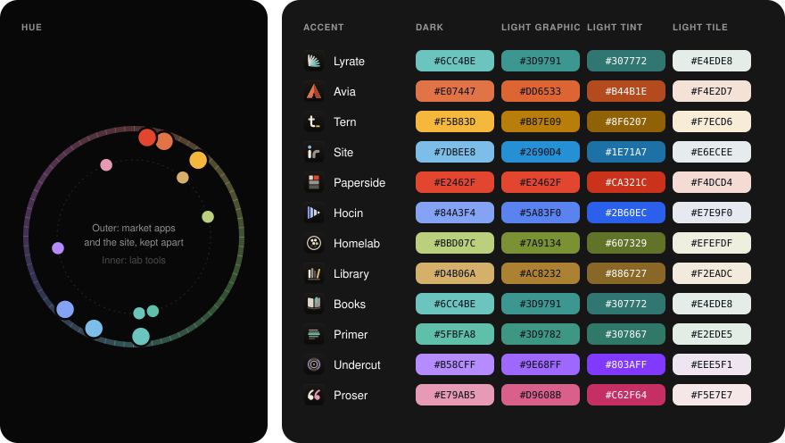
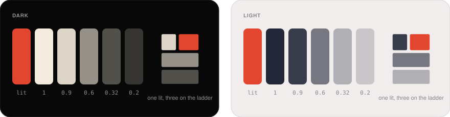
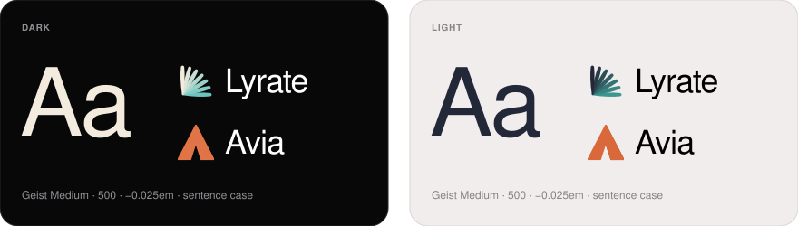

# Design

The design language behind my apps: how their marks are built, which colour does which job, and the type. Every app starts from here and copies its tokens and icons from here. There's nothing to install.



Lyrate, Avia and Tern are out; the other apps and tools haven't launched, so they go by the name of their mark.

## The system in six lines

1. **Marks are built from a few flat, rounded pieces, and one is lit.** The lit piece takes the product's accent; the rest step down a ladder of opacities. [Marks](docs/marks.md)
2. **Icons sit on a Night tile in dark mode, and on a cream tile washed with the accent in light mode.** One drawing; the appearance changes the fills.
3. **Text follows the platform.** iOS and macOS use the system's label colours, and the web mirrors them. Cream is never a text colour. [Colour](docs/colour.md)
4. **The grounds are ours:** a near-black Night in dark mode and a warm Light paper in light mode, on sheets and lists too.
5. **Cream is a light, and the accent is the tint.** Cream (Navy in light mode) fills the selected thing and the primary button; the accent colours tabs, toggles, progress and links.
6. **Names are set in Geist Medium,** in sentence case, tracked a little tight. Body text is each product's choice. [Type](docs/type.md)

## Colour

Each colour has one job, and the same screen reads the same in both appearances:



| Role | Its job | What it never does |
| --- | --- | --- |
| **Text** | Titles, labels, secondary lines: the system's own colours, so they match the tab bars, sheets and keyboards iOS draws itself. | Take on cream or the accent. |
| **Grounds** | The page, the surfaces on it, and the raised things on those. | Fall back to iOS's greys: sheets and grouped lists are set explicitly. |
| **Lit** | The selected or switched-on thing, and the primary button. Cream in dark mode, Navy in light mode. | Colour text on its own. |
| **Tint** | The product's accent, for tab selection, toggles, progress and links. Set once per app. | Mean a state. |
| **States** | Critical, fine and error text, shared by every product. | Become anyone's accent. |

### Grounds

Four layers per appearance. They stay ours everywhere, including the sheets and grouped lists that iOS would otherwise paint grey.



### Accents

Each product has one accent, taken from its own world (the comic's red, the tent's clay, the tyre's compound band) and kept at a pastel lightness, 4.9:1 or more on Night. The build derives every light-mode shade, so nobody picks them by hand. The light graphic shade is 3:1 on Light paper, for marks and controls. The light tint is 4.5:1, because a tint often colours text. The light tile is the accent washed 14% into cream.



Market apps and the site sit on a phone's home screen together, so they're kept apart on the wheel. Where two are close, as the comic's red and Avia's terracotta are, they differ in lightness and shape. Lab tools are only for me and may overlap with anything. Every value is in [docs/products.md](docs/products.md).

## Marks

Every mark is drawn in code on a 100×100 grid from two to seven flat pieces. One is lit in the accent; the rest are the ink colour (Paper on Night, Navy on cream) stepping down the ladder **1 · 0.9 · 0.6 · 0.32 · 0.2**.



Each mark comes from the product's world: Lyrate's riffled pages, Avia's tent, Tern's t and cursor, a comic's panels, a projector's beam. The build renders every mark four ways: a dark icon, a light icon, and a bare mark for dark and light pages. Lyrate and the Throw are the two exceptions to "one lit": their pieces fade at full strength from ink to the accent. The full rules are in [docs/marks.md](docs/marks.md).

## Type



Names are set in **Geist, weight 500, tracked −0.025em, in sentence case**. Body text is each product's choice; on Apple platforms the default is the system font, which matches the system's own chrome. Geist is under the SIL Open Font License, and a copy is in [`fonts/`](fonts/). More in [docs/type.md](docs/type.md).

## Using it

On the web, copy `dist/tokens.css` and pick the product's accent once:

```css
:root { --ds-accent: var(--ds-lyrate); --ds-tint: var(--ds-lyrate-tint); }
body { background: var(--ds-ground); color: var(--ds-text-primary); }
```

On iOS and macOS, copy `dist/Design.swift`, set the tint at the root, and use the system's text styles on our grounds:

```swift
ContentView()
    .tint(Design.Accent.lyrateTint)
    .background(Design.Ground.ground)
```

Icons are in `marks/out/<product>/`. Dark is the default on the web; light follows `prefers-color-scheme`, or set `data-theme="light"` or `"dark"` on `<html>`.

## Layout

| Path | What |
| --- | --- |
| `tokens/tokens.json` | The source of truth for colour, marks and type. |
| `marks/marks.mjs` | Every mark, drawn in code. |
| `marks/avia/` | Avia's own tent art (two PNG layers), recoloured by the build. |
| `scripts/build.mjs`, `scripts/figures.mjs` | Build everything below. Node, no dependencies. |
| `dist/tokens.css` | CSS custom properties (`--ds-*`), dark by default, light by media query or `data-theme`. |
| `dist/Design.swift` | SwiftUI colours for iOS and macOS (`Design.Ground.ground`, `Design.Accent.lyrateTint`…). |
| `dist/tokens.resolved.json` | Every value, light shades included. |
| `marks/out/<product>/` | `icon-dark.svg`, `icon-light.svg`, `mark-dark.svg`, `mark-light.svg`. |
| `dist/preview.html` | Every mark and colour on one page. |
| `docs/` | The guide, and `docs/img/`, the figures on this page. |
| `fonts/` | Geist, and its licence. |

## Build

```bash
node scripts/build.mjs
open dist/preview.html     # or xdg-open on Linux
```

Edit `tokens/tokens.json` or `marks/marks.mjs`, rebuild, and commit the outputs with the change. The figures on this page are rebuilt too, so they always show the current values.

## Adding a product

1. Decide its tier. A market app needs an accent clear of the other market apps and the site; a lab tool can take any free colour.
2. Pick its accent from its own world, at the pastel lightness of the others: about 4.9:1 or more on Night.
3. Add it to `tokens/tokens.json` with a one-line description of its mark, and draw the mark in `marks/marks.mjs` by the rules in [docs/marks.md](docs/marks.md).
4. Build, check `dist/preview.html` at every size, and copy `dist/tokens.css` or `dist/Design.swift` and its icons into the app.
5. Set the app's tint once and use the system's text colours from the start.

## Status

- Tokens and marks are decided. The reasoning, and the options turned down, are in [docs/decisions.md](docs/decisions.md).
- System text with cream as a light is decided but not yet in any app. It starts as a pilot on Lyrate's Books screen and Avia's Settings sheet, before the rest move over.
- `dist/Design.swift` hasn't been compiled yet; the pilot is its first use.

## Licence

The code, tokens and guide are under the [MIT licence](LICENSE). The marks, icons, Avia's tent art and the product names aren't: they identify my apps, so please don't use them in your own work. [NOTICE.md](NOTICE.md) has the details. Geist is under the [SIL Open Font License 1.1](fonts/Geist-OFL.txt).

This is my own design language, so I'm not taking issues or pull requests. You're welcome to fork it and borrow the method.
