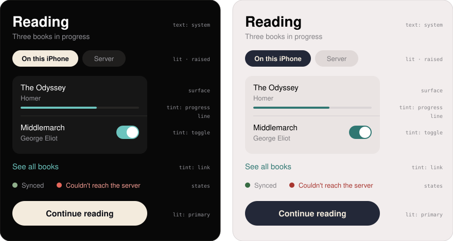
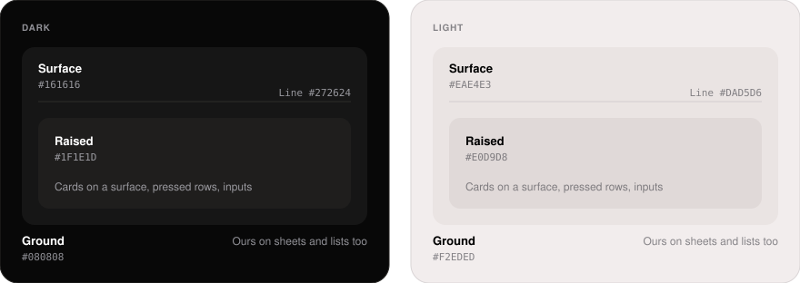
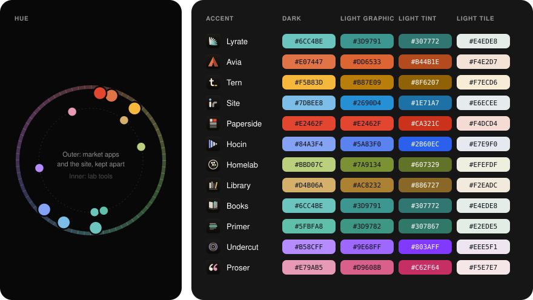

# Colour

## Roles (P2)

Each colour has one job. The values are in `tokens/tokens.json`; the build turns them into `dist/tokens.css` and `dist/Design.swift`.



| Role | Dark | Light | Rule |
| --- | --- | --- | --- |
| **Text and icons** | system: `#FFFFFF`, then `rgba(235,235,245)` at 60 / 30 / 18% | system: `#000000`, then `rgba(60,60,67)` at 60 / 30 / 18% | On iOS and macOS use `.primary` / `.secondary`. The web mirrors Apple's values. Never cream. |
| **Grounds** | Ground `#080808`, Surface `#161616`, Raised `#1F1E1D`, Line `#272624` | Ground `#F2EDED`, Surface `#EAE4E3`, Raised `#E0D9D8`, Line `#DAD5D6` | Ours, everywhere: override sheets and grouped lists too. |
| **Lit** | fill Paper `#F3EBDD`, text `#0C0E15` on it | fill Navy `#232838`, text Paper on it | The selected or lit thing (a chosen pill, a device that's on) and the primary button. Never text on its own. |
| **Tint** | the product's accent | the accent at 4.5:1 on Light paper | Tab selection, toggles, progress, links. Set once per app. |
| **Marks** | Paper units, accent lit | Navy units, accent's 3:1 shade lit | See [marks.md](marks.md). |
| **States** | critical `#E5675B`, fine `#8FAE8B`, error text `#F39C92` | critical `#A83630`, fine `#376B43`, error text `#A83630` | Shared by every product. Never an accent; an accent never means a state. |
| **Lab: ask** | `#E0A458` | `#95601C` | The lab tools' one amber: something waiting on your answer, as a dot or a word. Lab tools only. |

### Why system text

iOS draws parts of every screen itself: Liquid Glass tab bars and buttons, sheet headers, search, alerts, menus, the keyboard. Those are white (or black). When the app's own text was cream, every screen mixed the two: Lyrate's cream titles beside a white tab bar and search button, Avia's cream rows under a white Settings header. Some of those pieces can't be themed at all. So text follows the system, and cream keeps a job it does well: lighting things up.



## Accents

Each product has one accent, taken from its own world and kept at a pastel lightness (4.9:1 or more on Night). The build derives its light-mode shades so nobody hand-picks them:

- **Light graphic** (3:1 on Light paper): marks and controls on light pages.
- **Light tint** (4.5:1 on Light paper): the tint, since it often colours text (links, text buttons).
- **Light tile** (accent mixed 14% into `#F7F4EF`) and **tile lit** (3:1 on that tile): the light-mode icon.



The darker light shades are more saturated than the pastels (the Throw's tint is `#2B60EC`); that's the price of readable text on a light ground. Judge it on a real screen before changing the rule.

Market apps and the site must stay apart from each other on the colour wheel; lab tools may overlap. Every value is in [products.md](products.md).

## On the web

Copy `dist/tokens.css`, then set the product's accent once:

```css
:root { --ds-accent: var(--ds-lyrate); --ds-tint: var(--ds-lyrate-tint); }
body { background: var(--ds-ground); color: var(--ds-text-primary); }
```

Dark is the default; light follows `prefers-color-scheme`, or force either with `data-theme="light"` / `"dark"` on `<html>`.

## On iOS and macOS

Copy `dist/Design.swift`. Set the tint at the root, use system text styles, and our grounds:

```swift
ContentView()
    .tint(Design.Accent.lyrateTint)
    .background(Design.Ground.ground)
```

Sheets and grouped lists need their backgrounds set (`.scrollContentBackground(.hidden)` plus `Design.Ground.surface` on rows), or iOS draws its own greys.
