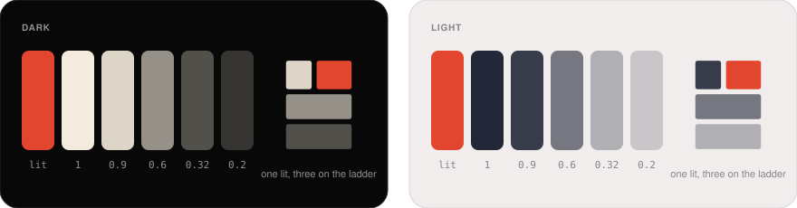

# Marks

## The grammar

Every mark is drawn on a 100×100 grid and follows four rules.

1. **Units.** Two to seven flat pieces with rounded corners (1.6 to 4.5 on the grid), circles or pills. No type, no gradients inside the mark. Two marks are made of letters, the site's initials and Tern's t, and both are drawn as pieces, not set in a face (decisions.md). A ring or a band is allowed when it is the thing itself (the dish, the tyre).
2. **One lit.** One piece is the product's accent. The rest are the ink colour stepping down the ladder: **1 · 0.9 · 0.6 · 0.32 · 0.2**. A product with no accent (the face) lights its brightest piece in full ink. Two exceptions fade at full strength from ink to the accent instead: Lyrate's pages, from an ink front page to an accent back page, which keeps the bright leading edge its fan was known for; and the Throw's beam, from an ink tip to the blue of the screen it lands on (decisions.md).

   
3. **Live area.** The mark sits in the middle ~62% of the tile (roughly 19 to 81 on the grid).
4. **Tells you what it is.** Each mark comes from the product's world: Lyrate's riffled pages, Avia's tent, Tern's t and cursor, the site's initials, a comic's panels, a projector's beam, a dish of lights, a shelf, an open book, a cited passage, a tyre.

## Four renderings

The build renders every mark four ways, into `marks/out/<product>/`.

| File | Ground | Ink | Lit piece | Use |
| --- | --- | --- | --- | --- |
| `icon-dark.svg` | Night tile, top-lit `#1C1A17 → #0B0A09` | Paper `#F3EBDD` | the accent | App icon in dark mode; favicons |
| `icon-light.svg` | Cream `#F7F4EF` washed 14% with the accent | Navy `#232838` | the accent darkened to 3:1 on its tile | App icon in light mode |
| `mark-dark.svg` | none (dark page) | Paper | the accent | Beside the wordmark on dark pages |
| `mark-light.svg` | none (light page) | Navy | the accent's light graphic shade | Beside the wordmark on light pages |

Both tiles carry a hairline at 8% (white on Night, black on cream) so they hold their edge on any wallpaper.

## App icons on Apple platforms

Build the icon in Icon Composer with **one layer per unit** (or per group of units at the same opacity). Give each layer a fill for the default (light) and dark appearances: the tile fill and the units' fills change, the drawing doesn't. Tinted and clear appearances then come from the layers for free, and tvOS's parallax layers are the same groups.

Avia keeps its own tent art (two PNG layers, `marks/avia/`); only its fills follow the rules: dark `#E07447` / `#A2462A` on Night, light `#D9693A` / `#8E3B22` on its tinted tile.

## Wordmark lockups

The mark sits left of the name, its height about 1.2× the name's cap height, with a gap of about a third of the mark's width. Names are in Geist Medium (see [type.md](type.md)). On a page, use the bare mark; the tiled icon is for places that show app icons.

## Adding a mark

Draw it in `marks/marks.mjs` as a function of the context `c` (`c.lit`, `c.ink`, `c.dark`, `c.ground`, `c.t`), using `tile()` for the frame. Keep to the grammar above, build, and check it in `dist/preview.html` at 64px, 29px and 20px in both appearances before it ships.
