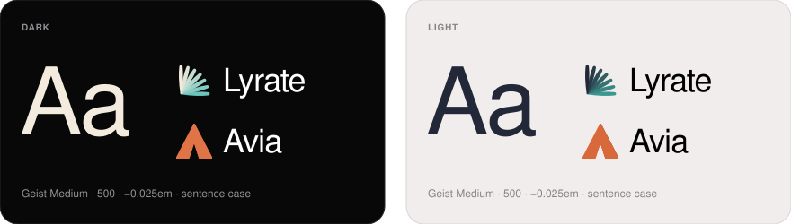

# Type

## Names: Geist Medium

Every product's name (the wordmark) and the lab tools' display numbers are set in **Geist, weight 500, tracked −0.025em, in sentence case**: "Lyrate", "Avia".

- Geist is under the SIL Open Font License 1.1, so it can be embedded in apps and served on the web. On the web load it from Google Fonts or self-host the woff2 in [`fonts/`](../fonts/); in an app, bundle the font file with its licence.
- The market apps use Geist by default but aren't bound to it. If an app needs a face of its own, it may change it; record the change and the reason in [decisions.md](decisions.md).
- Geist replaced Outfit on 2026-11-14. Apps still using Outfit move when they next touch their wordmark.

## Body text

Each product's choice. The default on Apple platforms is the system font (SF), which matches the system chrome; on the web, the system font stack (`-apple-system, system-ui, sans-serif`) or Geist.

Whatever the face, text colours follow the platform ([colour.md](colour.md)).

## Faces considered

Compared on 2026-11-14: Outfit, Sora, Plus Jakarta Sans (geometric); Geist, Inter Tight, Instrument Sans (grotesk); Figtree, Manrope, Onest (humanist). The finalists were Sora, Geist and Figtree; Geist was chosen.
